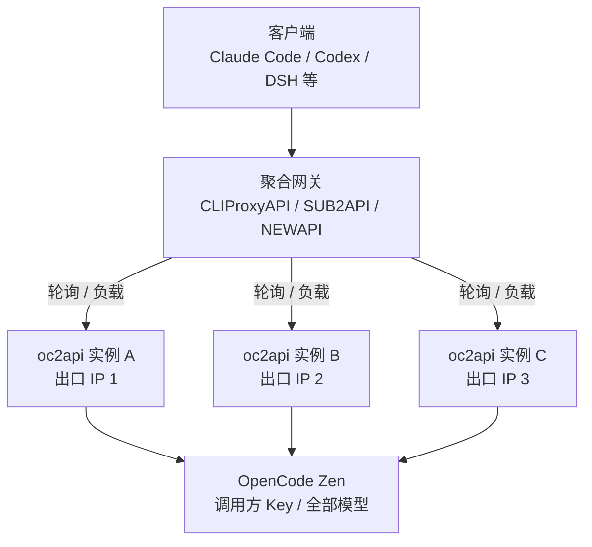

# oc2api

OpenCode 的 OpenAI 兼容代理，纯 Go 实现，支持 SSE 流式，可部署到 Vercel、Docker 或本地。

**用户自带 Key（BYOK）**：调用方传入自己的真实 OpenCode API Key，代理将其用于本次上游请求。
不再固定使用 `public`，也不再使用服务端 `API_KEY` 作为网关密码；缺少 Key 返回 `401`。
免费与付费模型均可请求，实际权限、额度与费用由该 Key 对应的 OpenCode 账号决定。



可接入 [router-for-me/CLIProxyAPI](https://github.com/router-for-me/CLIProxyAPI)、
[Wei-Shaw/sub2api](https://github.com/Wei-Shaw/sub2api)、[QuantumNous/new-api](https://github.com/QuantumNous/new-api)。
在网关渠道或客户端的 API Key 栏填写真实 **OpenCode Key**，不是另设的代理密码。
多个实例共享同一 Key 不会增加账号额度；`/ip` 可用于核对实例出口。

## 部署方式

<details>
<summary><b>1. Vercel</b> — 一键部署，或导入仓库手动部署</summary>

<br>

**一键部署：**

[](https://vercel.com/new/clone?repository-url=https%3A%2F%2Fgithub.com%2Fzhuweiyou%2Foc2api)

> 部署本次修改请导入你自己的仓库/分支；上游一键部署链接不包含尚未合并的 BYOK 改动。

**手动部署：**

1. Fork 本仓库到你的 GitHub
2. 打开 [Vercel Dashboard](https://vercel.com)，点击 **Add New > Project**
3. 选择你 Fork 的仓库，点击 **Import**
4. 无需配置服务端 Key；可在 **Environment Variables** 中设置 `DEBUG=true` 开启调试日志（可选）。
   旧的 `API_KEY` 环境变量已不再使用，可从部署配置中移除。
5. 点击 **Deploy**，等待部署完成

部署完成后会得到一个 `https://<项目名>.vercel.app` 的域名。

构建阶段会自动下载 Go 工具链、编译出 linux 二进制并随函数打包（`scripts/build-go.sh`），
首次部署大概 1–2 分钟。Vercel 的 Go runtime 会缓冲整段响应，所以 Vercel 上的流式由
`api/index.js` 这层薄 Node 转发实现，业务逻辑仍然全在 Go 二进制里。

你也可以 Fork 后部署多个 Vercel Project 做轮询、负载分摊；多个项目不保证出口 IP 不同，
需通过各自实例的 `/ip` 核对。

</details>

<details>
<summary><b>2. Docker</b> — 云函数、容器平台或自建服务器</summary>

<br>

**拉取镜像**

现成镜像在 [`ghcr.io/zhuweiyou/oc2api`](https://github.com/zhuweiyou/oc2api/pkgs/container/oc2api)：

```bash
docker pull ghcr.io/zhuweiyou/oc2api:latest

docker run -d --name oc2api --restart unless-stopped \
  -p 8080:8080 \
  ghcr.io/zhuweiyou/oc2api:latest
```

`latest` 跟着原仓库的最新版本走；**原仓库镜像不包含本次本地修改**，部署 BYOK 版本须从当前代码构建自己的镜像。

容器监听 `PORT`，默认 `8080`。镜像基于 `scratch`，里面只有静态二进制和 CA 证书。
云函数环境建议把超时调到 300 秒，否则长回答的流式响应会被提前截断。

**本地构建**

镜像定义与编排文件在 `docker/`。在项目根目录执行：

```bash
docker build -f docker/Dockerfile -t oc2api:byok .
docker run -d --name oc2api --restart unless-stopped -p 8080:8080 oc2api:byok
```

或使用 Compose：

```bash
docker compose -f docker/docker-compose.yml up -d --build
```

**无需本机安装 Go**：Dockerfile 在 `golang:1.24-alpine` 构建阶段完成编译。
上传到容器平台时，构建上下文选项目根目录、Dockerfile 路径填 `docker/Dockerfile`，
服务端口设为 `8080`（或配置 `PORT`），无需设置 `API_KEY` 或存储用户 Key。

</details>

<details>
<summary><b>3. 本地运行（Go）</b> — 调试与临时使用</summary>

<br>

要求 Go 1.24 或更高版本。

```bash
go run ./cmd/oc2api                # 默认 :8080
PORT=8080 go run ./cmd/oc2api
```

- `PORT`：监听端口，默认 `8080`
- `API_KEY`：已移除，不再读取；请求必须携带调用方 OpenCode Key
- `ZEN_API_BASE_URL`：上游站点根地址，默认 `https://opencode.ai`；接口路径由程序拼接，
  自建中继只填根地址即可
- `ZEN_CONNECT_TIMEOUT_MS`：建连、TLS 握手与等响应头的超时，默认 `60000`，允许 `1`–`600000`
- `DEBUG`：设为 `true` 输出调试日志

健康检查：

```bash
curl http://localhost:8080/health
```

</details>

## API

兼容 OpenAI 格式，路径均支持带 `/v1` 前缀或不带：

| 路径                                          | 方法 | 说明                                  |
| --------------------------------------------- | ---- | ------------------------------------- |
| `/v1/chat/completions` 或 `/chat/completions` | POST | Chat 补全（支持 `stream: true` 流式） |
| `/v1/models` 或 `/models`                     | GET  | 模型列表                              |
| `/` 或 `/health`                              | GET  | 健康检查                              |
| `/ip`                                         | GET  | 查询出口 IP                           |

模型列表和对话接口每次请求都必须携带调用方自己的 **OpenCode API Key**：

```text
Authorization: Bearer <your-opencode-key>
```

也支持 `X-API-Key: <your-opencode-key>`；同时提供时 `Authorization` 优先。
缺少/空凭据返回 `401`，不回退 `public`；Key 是否真实有效由 OpenCode 校验。
Key 仅用于当前请求及其内部重试，不保存到全局配置、不写入应用调试日志。
`/`、`/health`、`/ip` 与 CORS 预检保持公开。

```bash
# 获取该 Key 对应的上游模型列表
curl https://your-api.example/v1/models \
  -H "Authorization: Bearer $OPENCODE_API_KEY"

# 将 example-model 替换为模型列表中的实际 ID；stream=false 返回聚合 JSON
curl https://your-api.example/v1/chat/completions \
  -H "Authorization: Bearer $OPENCODE_API_KEY" \
  -H "Content-Type: application/json" \
  -d '{"model":"example-model","messages":[{"role":"user","content":"你好"}],"stream":true}'
```

客户端填写：Base URL 为 `https://your-api.example/v1`，API Key 为真实 OpenCode Key。
客户端工具映射与多轮对话沿用现有实现。

> 使用 HTTPS 保护传输；不要在请求 URL、公开配置或访问日志中记录 Key。
> 如自定义 `ZEN_API_BASE_URL`，调用方 Key 会发送到该地址，只能配置可信上游。

## 模型

代理不再限制模型名；`/v1/models` 返回上游提供的全部模型，不再仅保留免费模型。
付费模型是否可用、余额与计费均以上游账号权限为准。以下是原有免费模型示例：

| 模型                       | 上下文  | 输出   | 图片输入 |
| -------------------------- | ------- | ------ | -------- |
| `big-pickle`               | 200,000 | 32,000 | ❌       |
| `mimo-v2.6-flash-free`     | 200,000 | 32,000 | ✅       |
| `deepseek-v4.1-flash-free` | 200,000 | 32,000 | ✅       |
| `glm-5.3-flash-free`       | 200,000 | 32,000 | ✅       |

数据来源 [https://models.opencode.ai/api.json](https://models.opencode.ai/api.json)，以实际为准。

### 免费额度

额度由上游按账号/网络计量，代理本身没有配额。用完时上游回 `429` 并带 `Retry-After`（秒），
到期自动恢复；oc2api 会把该头原样透给客户端。

| 状态 | 错误类型                                  | 含义                           |
| ---- | ----------------------------------------- | ------------------------------ |
| 403  | `FreeTierError`                           | 请求不像 OpenCode 客户端       |
| 429  | `FreeUsageLimitError`（带 `Retry-After`） | 额度用尽，或该出口已被上游限流 |

免费层仍可能受出口网络限制，但更换出口不会增加 Key 对应的账号余额。
使用付费模型可能产生费用；上游 `401`/`403`/`429` 会保留状态码，`Retry-After` 在存在时透传。

## 开发

```bash
go test ./...              # 离线单元测试（真实上游测试默认跳过）
go vet ./...
go build ./...             # 编译检查
golangci-lint run ./...    # lint（配置见 .golangci.yml）
node --test api/index.test.mjs # Vercel 薄层离线测试，无需 Go
```

实现细节（为什么用 uTLS、免费层的形状要求、Vercel 为什么是薄 Node 层）见 [AGENTS.md](AGENTS.md)。
